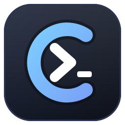
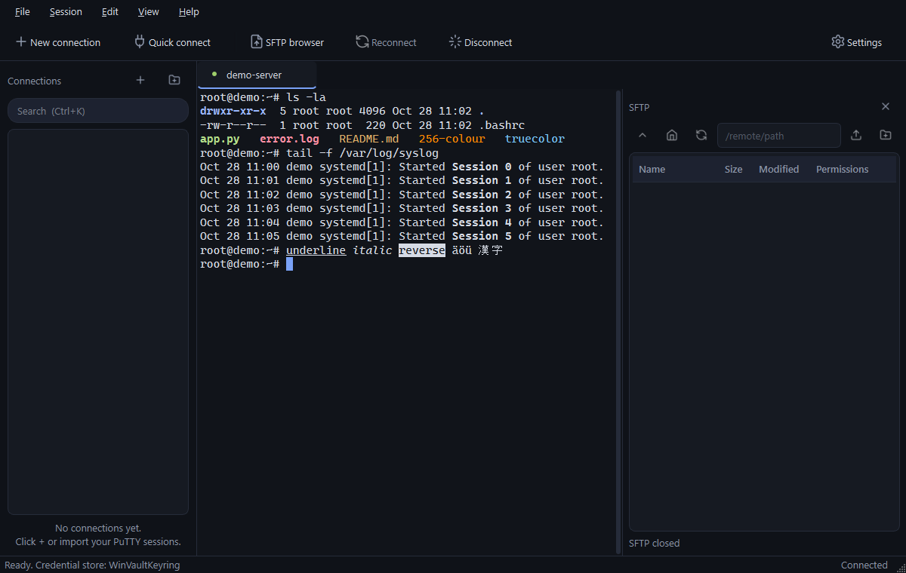

<p align="center">
  
</p>

# Conduit

A modern SSH client for people who are tired of PuTTY's 1990s look but still need the same
workflow: a list of saved servers, one click to connect, key files, tabs, and a file browser.

Written in Python with PySide6 (Qt), paramiko and pyte. MIT licensed.



## Features

- **Saved connections** with host, port, user name, password or private key, grouped in folders
  and searchable (`Ctrl+K`).
- **Secrets stay out of the config file.** Passwords and key passphrases are stored in the
  operating system's credential store (Windows Credential Manager, macOS Keychain, Secret Service
  on Linux) via `keyring`. The JSON file only holds host, user and key path.
- **Private keys in OpenSSH and PuTTY format.** `.ppk` files (version 2 and 3, encrypted or not)
  are loaded directly, so existing PuTTY keys keep working without conversion.
- **Import your PuTTY sessions** from the registry (Windows) or `~/.putty/sessions`.
- **Tabs**: several sessions side by side, with a status dot per tab and optional per-connection
  colours.
- **Terminal emulator** with 256 and true colour, bold/italic/underline, scrollback, selection,
  copy on select, right-click paste (PuTTY style, switchable), bracketed paste, alternate screen for
  `vim`, `htop`, `less`, and window-title reporting.
- **SFTP browser** next to the terminal (`Ctrl+Shift+F`): browse, download, upload (also by
  drag and drop from Explorer), rename, delete, create folders, with transfer progress.
- **Host key verification** with an app-owned `known_hosts` file and a clear fingerprint dialog.
  Changed host keys are refused.
- **Dark and light theme**, configurable font and scrollback, keep-alive, quick connect without
  saving, startup command per connection.

## Install

Requires Python 3.11 or newer.

```bash
git clone https://github.com/paulwenzlaff/conduit.git
cd conduit
python -m venv .venv
.venv\Scripts\activate          # Windows
# source .venv/bin/activate     # macOS / Linux
pip install -e .
conduit
```

`conduit-gui` starts the app without a console window on Windows.

### Windows executable

Every tagged release (`v*`) builds a zip with `Conduit.exe` through GitHub Actions
(see `.github/workflows/release.yml`). To build it locally:

```powershell
.\scripts\build_exe.ps1 -Zip
```

The result is in `dist\Conduit\`.

## Usage

| Action | Shortcut |
| --- | --- |
| New connection | `Ctrl+Shift+N` |
| Quick connect (not saved) | `Ctrl+Shift+Q` |
| Search connections | `Ctrl+Shift+K` |
| Toggle SFTP browser | `Ctrl+Shift+F` |
| Copy / paste in terminal | `Ctrl+Shift+C` / `Ctrl+Shift+V` (also `Shift+Insert`, middle click, right click) |
| Scroll back | mouse wheel, `Shift+PageUp` / `Shift+PageDown` |
| Reconnect | `Ctrl+Shift+R` |
| Close tab | `Ctrl+Shift+W` |
| Next / previous tab | `Ctrl+Tab` / `Ctrl+Shift+Tab` |
| Toggle sidebar | `Ctrl+Shift+B` |
| Switch theme | `Ctrl+Shift+T` |
| Settings | `Ctrl+Shift+S` |

Everything with a plain `Ctrl` (`Ctrl+C`, `Ctrl+D`, `Ctrl+Z`, `Ctrl+K`, ...), `Tab`, `Esc`, the arrow and
function keys go to the remote shell, exactly like in PuTTY. Application shortcuts therefore all use
`Ctrl+Shift`.

### Where data is stored

| What | Where (Windows) |
| --- | --- |
| Connections and groups | `%APPDATA%\Conduit\connections.json` |
| Settings | `%APPDATA%\Conduit\settings.json` |
| Trusted host keys | `%APPDATA%\Conduit\known_hosts` |
| Passwords and passphrases | Windows Credential Manager, entries named `Conduit` |

On macOS and Linux the equivalent user config directories are used (`platformdirs`).

## Development

```bash
pip install -e ".[dev]"
pytest
```

The test suite covers the `.ppk` parser (round trip for RSA, Ed25519 and ECDSA keys, encrypted
and plain, v2 and v3), the connection store, the PuTTY import parser, and a full SSH session
against an in-process paramiko server (host key prompt, authentication, resize, I/O).

Project layout:

```
conduit/
  app.py               entry point
  core/                no Qt widgets here
    models.py          Connection dataclass
    storage.py         JSON store with groups and search
    secrets.py         keyring wrapper
    keys.py, ppk.py    private key loading (OpenSSH + PuTTY)
    ssh_session.py     paramiko shell on a worker thread
    sftp_session.py    SFTP job worker
    known_hosts.py     host key policy
    putty_import.py    registry / file import
  ui/
    main_window.py     menus, toolbar, tabs
    sidebar.py         grouped connection tree
    session_tab.py     terminal + banner + SFTP splitter
    terminal_widget.py pyte based terminal emulator
    sftp_panel.py      remote file browser
    connection_dialog.py, dialogs.py, putty_import_dialog.py
    theme.py, icons.py
```

## Known limitations

- No port forwarding, X11 forwarding or serial/telnet sessions yet.
- Folder download in the SFTP panel is not implemented (folder upload is).
- Mouse reporting to remote applications is not implemented; the wheel is translated to arrow
  keys in full-screen programs.
- DSA keys are not supported (paramiko 4+ dropped them).

## License

Conduit itself is released under the MIT License, see [LICENSE](LICENSE). The logo and the
inline icons in `conduit/ui/icons.py` are part of the project and covered by the same license;
the icons follow the style of [Lucide](https://lucide.dev) (ISC).

### Third-party components

Conduit depends on the following libraries, which keep their own licenses. They are pulled in
through `pip` and, in the Windows build, bundled as separate files next to `Conduit.exe`.

| Component | License |
| --- | --- |
| [PySide6 / Qt for Python](https://www.qt.io/qt-for-python) | LGPL-3.0 (Qt libraries are dynamically linked and can be replaced) |
| [paramiko](https://www.paramiko.org/) | LGPL-2.1 |
| [pyte](https://github.com/selectel/pyte) | LGPL-3.0 |
| [cryptography](https://cryptography.io/) | Apache-2.0 / BSD-3-Clause |
| [keyring](https://github.com/jaraco/keyring) | MIT |
| [platformdirs](https://github.com/platformdirs/platformdirs) | MIT |
| [argon2-cffi](https://github.com/hynek/argon2-cffi) | MIT |

If you redistribute the Windows build, keep this notice (or the license files PyInstaller places
in `_internal/`) with it so the LGPL attribution requirements for Qt, paramiko and pyte are met.
